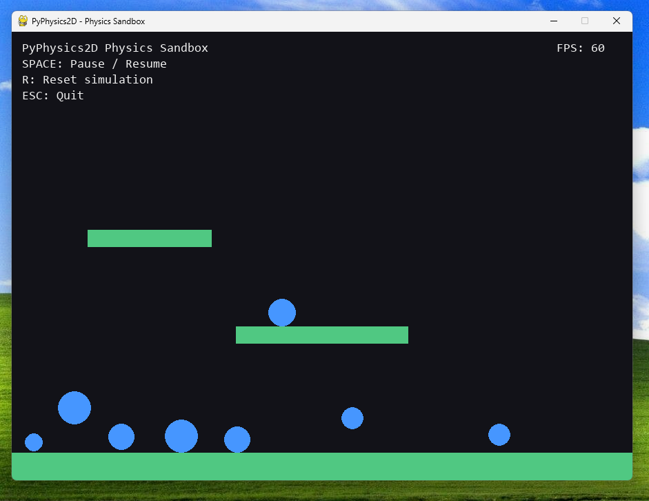

# Physics2D

A 2D physics engine built from scratch in Python, featuring rigid-body movement, collision detection, collision response, gravity, and an interactive Pygame sandbox.

## Features

- **Vector Mathematics** — 2D vector operations, magnitude, normalization, and dot products.
- **Rigid Bodies** — Circular and rectangular physical bodies.
- **Collision Detection** — Circle-circle, circle-rectangle, and rectangle-rectangle collisions.
- **Collision Resolution** — Collision response using impulses and positional correction.
- **Gravity** — Configurable gravitational acceleration.
- **Static Bodies** — Immovable objects such as floors and platforms.
- **World Boundaries** — Objects respond to the simulation boundaries.
- **Fixed Timestep** — Consistent physics updates using a fixed simulation timestep.
- **Interactive Sandbox** — Visualize physics simulations using Pygame.

## Preview

Run the sandbox to see circles falling, colliding, and interacting with rectangular platforms.



## Technologies

- Python
- Pygame CE
- Object-Oriented Programming
- Physics and Mathematics

## Installation

### 1. Clone the repository

```bash
git clone https://github.com/FranzHermann12/2-D-Physics-Engine.git
```

### 2. Enter the project directory

```bash
cd 2-D-Physics-Engine
```

### 3. Create a virtual environment (optional)

```bash
python -m venv .venv
```

Activate it on Windows:

```powershell
.venv\Scripts\Activate.ps1
```

### 4. Install dependencies

```bash
pip install -r requirements.txt
```

### 5. Run the physics sandbox

```bash
python main.py
```

## Controls

| Key | Action |
|---|---|
| `SPACE` | Pause / Resume simulation |
| `R` | Reset simulation |
| `ESC` | Exit |

## Project Structure

```text
2-D-Physics-Engine/
│
├── physics/
│   ├── __init__.py
│   ├── vector.py
│   ├── body.py
│   ├── rectangle.py
│   ├── collision.py
│   └── world.py
│
├── tests/
│   ├── __init__.py
│   ├── test_physics.py
│   └── test_*.py
│
├── main.py
├── requirements.txt
├── README.md
├── LICENSE
└── .gitignore
```

## Running Tests

Run the automated test suite:

```bash
python -m unittest discover -s tests -p "test_physics.py" -v
```

The project also includes manual test scripts for individual physics components.

## Project Goals

This project is an exploration of the mathematics and programming concepts behind 2D physics simulations.

Future development may include:

- Improved friction simulation.
- Rotational rigid-body physics.
- Angular velocity and torque.
- More advanced collision detection.
- Spatial partitioning for performance.
- Additional physical objects and constraints.

## License

This project is licensed under the MIT License. See [LICENSE](LICENSE) for details.

## Author

**Franz Hermann**

GitHub: [@FranzHermann12](https://github.com/FranzHermann12)

---
